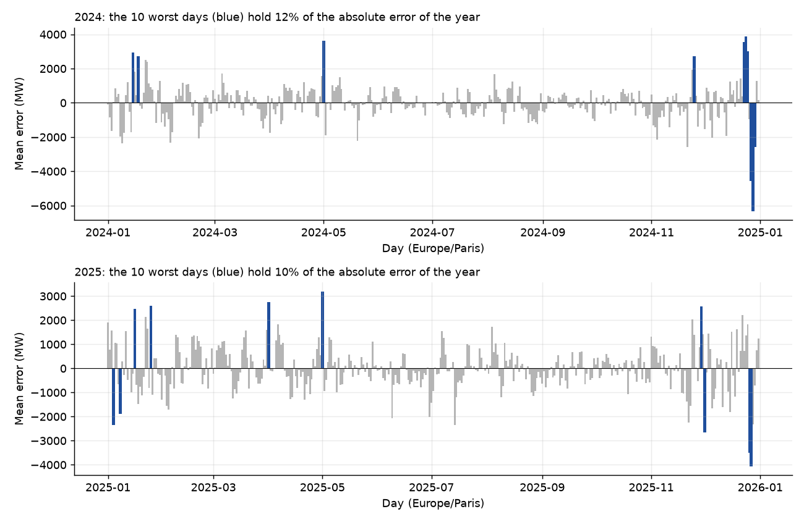
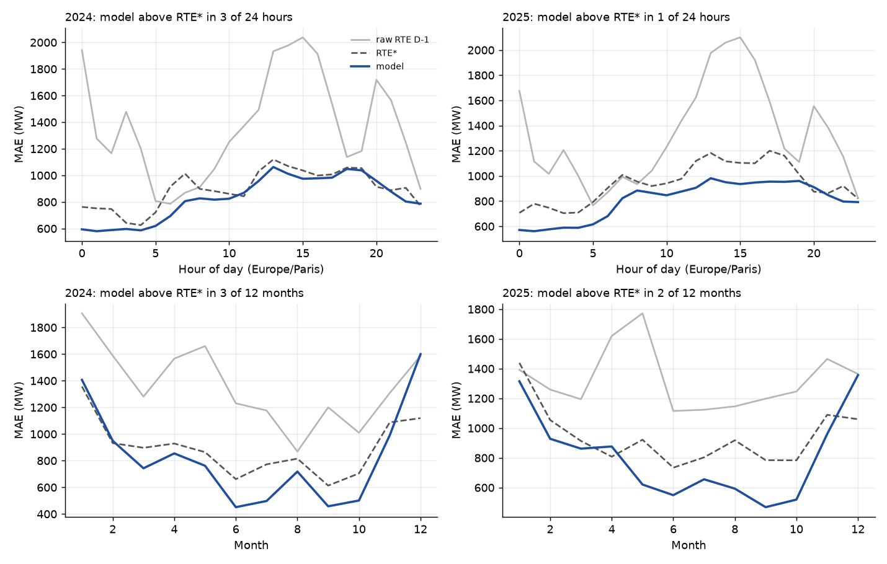
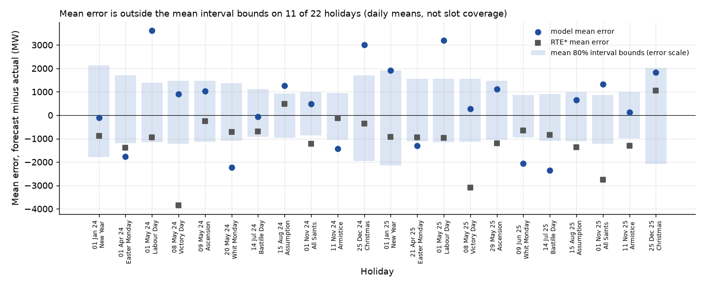
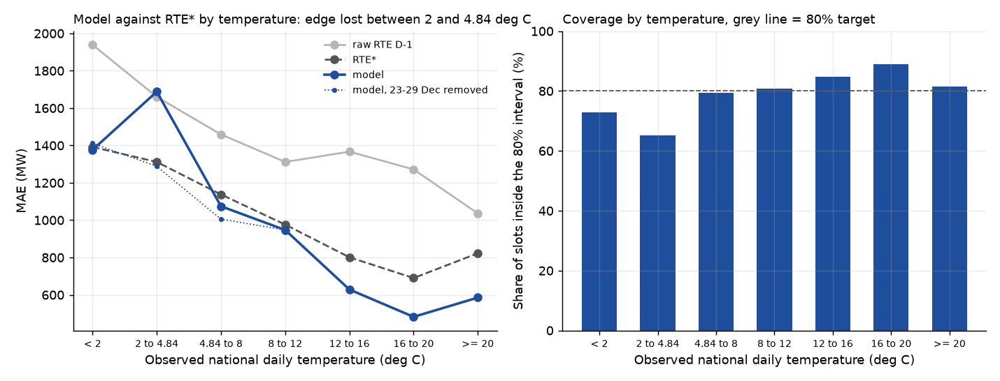

# Error analysis of the final system, 2024 and 2025

System: candidate 1 of decision D18, the EXP-009 aggregation point forecast with the EXP-012 seasonal conformal 80 percent interval.
No model is fitted here. Everything comes from `python scripts/run_error_analysis.py`, which prints every table below (new logs go in `data/experiments/error_analysis/run.log`; I keep the original log in the historical archive).

Inputs. Forecasts and intervals of 2024 are `data/experiments/EXP-012/intervals.csv`, those of 2025 are `data/experiments/TEST-2025/intervals.csv`.
Consumption and raw RTE D-1 come from a development build of the clean model `load_30min`, read for 2023-01-01 to 2025-12-31 Paris only. RTE* is rebuilt with the D15 rule (prior year mean error by local hour) and the script stops unless it reproduces the accepted MAE of both years: model 828.52 and 808.81 MW, raw RTE 1364.58 and 1324.98 MW, RTE* 896.65 and 942.57 MW.
Temperature is the observed SYNOP national daily mean of the D9 labels (evaluation ground truth, never a model input). The GFS forecast temperature is not used here, so an error caused by the weather forecast cannot be separated from a model error.
Bias means forecast minus actual. All statements about causes are hypotheses unless a number is given. The 2025 numbers are the same single test run as TEST-2025: nothing here changes a setting or a conclusion of it.

## 1. The worst days

I rank the days by the daily MAE of the model on the common slots. The 10 worst days hold 11.9 percent of the absolute error of 2024 and 9.7 percent of 2025 (the 20 worst: 19.5 and 17.0 percent). The error is not driven by a handful of days, but it is concentrated in the same places.

2024. Columns: daily MAE of the model, mean error, daily MAE of RTE* and of raw RTE (MW), share of slots inside the interval.

| day | type, temperature | model | bias | RTE* | raw RTE | coverage | factual reading |
|---|---|---|---|---|---|---|---|
| Sat 28 Dec | cold, 2.1 deg C | 6335 | -6335 | 1883 | 3014 | 0 % | week after Christmas, whole day under-forecast |
| Fri 27 Dec | cold, 2.8 | 4559 | -4559 | 2499 | 3627 | 2 % | D-2 was Christmas day (lag day is a holiday) |
| Tue 24 Dec | ordinary, 7.2 | 3884 | +3884 | 1526 | 878 | 2 % | Christmas Eve, actual 58.5 GW against 65.0 GW a week earlier |
| Wed 1 May | holiday, 14.2 | 3610 | +3610 | 998 | 2086 | 0 % | Labour Day, actual 41.5 GW |
| Mon 23 Dec | ordinary, 6.4 | 3551 | +3551 | 1209 | 2321 | 23 % | Christmas week, over-forecast |
| Mon 15 Jan | cold, 3.2 | 3125 | +2934 | 3028 | 1909 | 40 % | cold spell, actual 72.1 GW, RTE* also misses by 3.0 GW |
| Wed 25 Dec | holiday, 7.0 | 2997 | +2997 | 698 | 1568 | 0 % | Christmas day, over-forecast |
| Thu 18 Jan | ordinary, 6.3 | 2718 | +2718 | 1019 | 2033 | 21 % | D-2 was cold, load 8.1 GW below D-7, no holiday or bridge label |
| Mon 25 Nov | ordinary, 13.7 | 2711 | +2711 | 1390 | 1170 | 0 % | mild Monday, actual 54.3 GW, no calendar, temperature or data cause found |
| Sun 29 Dec | cold, 2.2 | 2594 | -2594 | 982 | 899 | 29 % | week after Christmas, under-forecast |

2025.

| day | type, temperature | model | bias | RTE* | raw RTE | coverage | factual reading |
|---|---|---|---|---|---|---|---|
| Sat 27 Dec | cold, 3.5 | 4062 | -4062 | 1740 | 2843 | 0 % | D-2 was Christmas day, load 10.9 GW above D-7 |
| Fri 26 Dec | bridge, 3.6 | 3495 | -3495 | 2025 | 2506 | 6 % | D8 labels it a bridge (Friday after Christmas Thursday), load 65.0 GW, 8.5 GW above D-7 |
| Thu 1 May | holiday, 19.5 | 3200 | +3200 | 1442 | 2196 | 4 % | Labour Day, actual 37.0 GW, same sign and size as 2024 |
| Tue 1 Apr | ordinary, 11.1 | 2749 | +2749 | 832 | 1120 | 29 % | backup day: the D-2 lag day is the 23-hour change day (30 March), so the lag block is missing |
| Mon 1 Dec | ordinary, 5.6 | 2658 | -2658 | 1932 | 3079 | 8 % | first Monday of December, every forecast misses, raw RTE by 3.1 GW |
| Sat 25 Jan | ordinary, 10.7 | 2604 | +2604 | 2557 | 1420 | 12 % | mild Saturday, load 15.0 GW below D-7, RTE* also misses by 2.6 GW |
| Sat 29 Nov | ordinary, 8.2 | 2586 | +2586 | 1897 | 935 | 0 % | load 10.8 GW below D-7, no holiday or bridge label |
| Thu 16 Jan | cold, 3.6 | 2467 | +2467 | 2108 | 1072 | 27 % | cold spell, actual 73.3 GW |
| Wed 8 Jan | ordinary, 9.0 | 2445 | -1900 | 824 | 1240 | 44 % | signed error changes sign during the day |
| Sat 4 Jan | cold, 3.2 | 2358 | -2358 | 686 | 1567 | 52 % | cold Saturday, under-forecast |

Readings.
- Christmas to New Year is the largest single failure. The days from 23 to 29 December hold 6 of the 10 worst days of 2024 and 2 of the 10 worst of 2025. Their mean daily MAE is 3617 MW (2024) and 2179 MW (2025), against 774 and 782 MW on the other days, and RTE* scores 1452 and 1428 MW on the same week. Without these 7 days the annual MAE of the model is 774.1 and 782.0 MW (instead of 828.5 and 808.8), and that of RTE* is 885.8 and 933.1 MW (instead of 896.6 and 942.6). The lead of the model over RTE* is -111.7 MW and -151.1 MW without the week, against -68.1 MW and -133.8 MW with it (descriptive, made after seeing the results, no test). The week costs the model 44 MW of its lead in 2024 and 17 MW in 2025.
- The sign alternates inside the week: over-forecast on 23 to 25 December, under-forecast on 26 to 29 December. Hypothesis: the calendar features describe 25 December as a holiday and nothing else of the period, and the D-2 and D-7 lags carry the holiday level to the days after it (27 December has Christmas day as D-2 in both years). EXP-004 recorded the same weakness of one lag slope for every day type.
- Labour Day (1 May) is the same miss in both years, +3.6 and +3.2 GW, with a load much lower than a normal weekday (41.5 and 37.0 GW, against 55.6 and 49.2 GW a week earlier). See section 3.
- On every one of the 20 worst days the model is worse than RTE*, and worse than raw RTE on 19 of them. This is a selection effect and not a finding: ranking days by the model's own error picks the days where it happens to fail. It does show that the failures are not shared with RTE, which is consistent with a calendar reading (RTE operators know the holiday period), among other readings.
- Weather changes: 13 of the 19 worst days with a D-7 value have a load more than 4 GW away from D-7, against 27 percent of all days (6 of 10 in 2024, 7 of 9 in 2025). Hypothesis: on days when the temperature moves away from the previous week, the lags hold a stale level. I did not test it.
- Backup forecasts: two days of each year have a missing lag block (2 April and 7 April 2024, 1 April and 6 April 2025, found by running `lag_features` on the actuals). Their daily MAE is 1206, 1320, 2749 and 1821 MW. On these days the point experts fall back to a forecast without lags (rule of EXP-004). This is 4 days in 2 years and not the 8 days written in TEST-2025.md (192 slots per expert over 2024 and 2025 are 4 days of 48 slots).

Conclusion: 8 of the 20 worst days are in the Christmas week, where the model is worse than RTE* on every one of them and the errors change sign. The others include load swings against D-7 (more than 4 GW on 13 of 19), 1 May and the backup day after a spring change. These are associations. Calendar, lag, weather and forecast-input explanations are hypotheses that this note does not test, and they are not exclusive.

## 2. Error by local hour and by month

MAE by Paris local hour (MW), every third hour shown, full table in the log.

| hour | 0 | 3 | 6 | 9 | 12 | 15 | 18 | 21 |
|---|---|---|---|---|---|---|---|---|
| 2024 model | 594 | 597 | 694 | 817 | 957 | 975 | 1048 | 878 |
| 2024 RTE* | 763 | 643 | 915 | 882 | 1030 | 1037 | 1058 | 889 |
| 2024 raw RTE | 1942 | 1478 | 786 | 1049 | 1493 | 2038 | 1138 | 1565 |
| 2025 model | 571 | 589 | 681 | 865 | 906 | 935 | 953 | 846 |
| 2025 RTE* | 707 | 704 | 904 | 920 | 1120 | 1104 | 1161 | 865 |
| 2025 raw RTE | 1676 | 1206 | 870 | 1042 | 1625 | 2101 | 1218 | 1378 |

MAE by month (MW), model / RTE* / raw RTE, and coverage of the 80 percent interval (percent).

| month | 1 | 2 | 3 | 4 | 5 | 6 | 7 | 8 | 9 | 10 | 11 | 12 |
|---|---|---|---|---|---|---|---|---|---|---|---|---|
| 2024 model | 1407 | 949 | 743 | 855 | 762 | 451 | 498 | 718 | 458 | 501 | 990 | 1600 |
| 2024 RTE* | 1357 | 932 | 897 | 929 | 864 | 661 | 773 | 815 | 613 | 705 | 1088 | 1119 |
| 2024 raw RTE | 1906 | 1589 | 1281 | 1566 | 1660 | 1231 | 1177 | 869 | 1200 | 1010 | 1308 | 1588 |
| 2024 coverage | 74.7 | 91.7 | 87.1 | 81.0 | 82.6 | 90.3 | 87.2 | 65.7 | 86.1 | 85.7 | 58.5 | 71.4 |
| 2025 model | 1315 | 928 | 862 | 877 | 621 | 549 | 656 | 593 | 468 | 519 | 961 | 1356 |
| 2025 RTE* | 1439 | 1054 | 914 | 808 | 922 | 734 | 803 | 918 | 785 | 784 | 1089 | 1060 |
| 2025 raw RTE | 1392 | 1259 | 1194 | 1620 | 1772 | 1115 | 1124 | 1146 | 1198 | 1247 | 1465 | 1364 |
| 2025 coverage | 78.9 | 92.9 | 77.1 | 76.7 | 89.9 | 86.4 | 74.9 | 83.6 | 91.9 | 85.0 | 59.6 | 77.3 |

Readings.
- Raw RTE has a strong daily shape: its error peaks at 13 to 16 h (about 2000 MW) and at midnight, and is smallest at 5 to 6 h. RTE* removes the mean by hour, which flattens it to 630 to 1200 MW. The model is the flattest, from 560 MW at night to 950 to 1060 MW in the afternoon and evening. It is below RTE* in 21 of 24 hours in 2024 (above it at 11, 20 and 23 h) and in 23 of 24 hours in 2025 (above it at 20 h only). The hours are not a weak spot.
- By month the model is above RTE* in January, February and December 2024 and in April and December 2025. December is the worst month of the model in both years (1600 and 1356 MW), and it is the month holding the Christmas week of section 1. June to October are 450 to 720 MW in both years, while November is 990 and 961 MW.
- The monthly coverage of the interval is unstable and the instability repeats: November is under-covered both years (58.5 and 59.6 percent), February over-covered (91.7 and 92.9). In every season of both years, the month with the highest MAE is also the month with the lowest coverage (8 of 8 season-years, descriptive). Hypothesis: the seasonal pool of EXP-012 averages months with different error scales (September and October at 460 to 520 MW, November at 960 to 990 MW), so it would be too wide for the calm months and too narrow for the hard one. I did not test it. The grouping improved the season averages, which are still not all inside 78 to 82 percent (section 5, item 4).

Conclusion: the point forecast is below RTE* at almost every hour and in most months, its weak months are December and January, and the interval coverage varies much more by month (58 to 93 percent) than by season average. Seasonal calibration is improved, not achieved: by season, coverage is 79.0, 83.6, 81.0 and 76.9 percent in 2024 and 82.7, 81.3, 81.6 and 78.9 in 2025 (winter, spring, summer, autumn), and TEST-2025 did not show it.

## 3. Holidays

Mean error of the model on each of the 22 national holidays of 2024 and 2025 (MW, forecast minus actual), with the share of slots inside the interval, the interval width and the number of holidays inside its calibration pool. In the figure the blue band is the day's mean lower and upper bound written on the same error scale (model minus bound). The bounds are asymmetric, so the band is not centred on zero (centre offset up to 249 MW). The mean error is outside the mean bounds on 11 of 22 holidays. This compares daily means and is not the slot coverage of the table.

| holiday | 2024 day | bias | coverage | width | in pool | 2025 day | bias | coverage | width | in pool |
|---|---|---|---|---|---|---|---|---|---|---|
| New Year | Mon | -95 | 54 % | 3913 | 2 | Wed | +1907 | 40 % | 4053 | 2 |
| Easter Monday | Mon | -1757 | 17 % | 2911 | 5 | Mon | -1310 | 35 % | 2682 | 4 |
| Labour Day | Wed | +3610 | 0 % | 2543 | 5 | Thu | +3200 | 4 % | 2727 | 5 |
| Victory Day | Wed | +913 | 62 % | 2687 | 5 | Thu | +271 | 100 % | 2691 | 5 |
| Ascension | Thu | +1029 | 79 % | 2601 | 4 | Thu | +1123 | 71 % | 2529 | 3 |
| Whit Monday | Mon | -2232 | 2 % | 2464 | 5 | Mon | -2066 | 10 % | 1816 | 2 |
| 14 July | Sun | -57 | 100 % | 2051 | 2 | Mon | -2346 | 4 % | 1986 | 3 |
| 15 August | Thu | +1256 | 17 % | 1897 | 2 | Fri | +643 | 67 % | 2097 | 3 |
| 1 November | Fri | +476 | 62 % | 1861 | 2 | Sat | +1318 | 27 % | 2073 | 2 |
| 11 November | Mon | -1430 | 27 % | 1992 | 2 | Tue | +124 | 44 % | 1981 | 2 |
| Christmas | Wed | +2997 | 0 % | 3663 | 2 | Thu | +1839 | 58 % | 4092 | 2 |

Totals. 2024: model MAE 1641 MW, RTE* 1187, raw RTE 2068, mean coverage 38.3 percent. 2025: model 1600, RTE* 1566, raw RTE 2438, mean coverage 41.9 percent. The model beats raw RTE both years. It loses to RTE* in 2024 by 454 MW and ties it in 2025 (+34 MW, on 11 days, no test).

Which holidays fail.
- Labour Day, Whit Monday and Easter Monday in both years, Christmas 2024 and Bastille Day 2025: mean error beyond 1.3 GW and coverage under 36 percent. Easter Monday, Whit Monday and Bastille Day 2025 are under-forecast every time (-1.3 to -2.3 GW).
- The sign follows the weekday. The 7 Monday holidays are all under-forecast (mean -1605 MW, from -2346 to -95). The 14 holidays from Tuesday to Saturday are all over-forecast (mean +1479 MW, from +124 to +3610). The Sunday one (14 July 2024) is -57 MW. The error therefore depends on the weekday of the holiday. Hypothesis, from the EXP-004 note: the model treats a holiday like a Sunday for the calendar, but its lags come from the weekdays around it (a Saturday D-2 for a Monday holiday, a working weekday D-2 for the others). I did not test it.

Why the conformal pool cannot calibrate holidays.
- The EXP-012 pool of a slot holds about 90 residuals (the same season, 365 days ending at D-2). The lower and the upper bound are the 9th residual from each end (ranks 9 and 82 of 90). Only 2 to 5 holidays are in a given pool (column "in pool"), fewer than the 9 residuals a tail holds, so holidays cannot fill a tail alone. They are not without effect: a few extreme residuals shift the ranks of the ordinary ones (in a synthetic check by the reviewer, two extremes moved rank 82 by two places). The bound is still set mainly by ordinary days, and the method guarantees coverage on average over the pooled days, not on a subset such as holidays.
- The holiday errors (1.3 to 3.6 GW on the worst days) are far larger than the half-width of 1.0 to 2.0 GW, which is consistent with a different error distribution from ordinary days. I did not test exchangeability, so this is not shown. The sign depends on the weekday, so a single holiday pool would have to cover both signs.
- Post-hoc check (made after seeing the results, 22 holidays of both years, nothing selected): a per-slot conformal interval built from the other 21 holidays, left out one at a time, covers 81.8 percent of the slots of the left-out holiday but is 5666 MW wide on average, 2.2 times the 2605 MW of the seasonal interval on the same days (coverage 40.1 percent). This is one route and I did not look for others (a holiday scale factor, a weekday split). It shows that a pooled holiday-only interval with 11 events a year and two years of history is very wide.

Conclusion: holidays are a weak point of the point forecast (about equal to RTE* in 2025, worse in 2024, always better than raw RTE) and of the interval (about 40 percent coverage). The signed error follows the weekday in these 21 non-Sunday holidays, which is an association and not a cause. Hypotheses: the calendar and lag mechanism above, and a seasonal conformal pool dominated by ordinary days that cannot cover 11 events a year. Neither is tested.

## 4. Cold days

I group the ordinary and cold days of 2024 and 2025 (holidays, bridges and DST days removed so that they do not blur the temperature effect) by observed national daily temperature. MAE in MW, bias is forecast minus actual, coverage in percent.

| temperature (deg C) | days | model | RTE* | raw RTE | bias | coverage |
|---|---|---|---|---|---|---|
| below 2 | 19 | 1377 | 1392 | 1939 | -711 | 73 |
| 2 to 4.84 | 34 | 1688 | 1312 | 1660 | -562 | 65 |
| 4.84 to 8 | 89 | 1074 | 1138 | 1459 | +179 | 79 |
| 8 to 12 | 139 | 947 | 976 | 1312 | +100 | 81 |
| 12 to 16 | 154 | 629 | 801 | 1367 | +101 | 85 |
| 16 to 20 | 130 | 482 | 690 | 1272 | +13 | 89 |
| 20 and above | 128 | 585 | 822 | 1036 | -161 | 81 |

Readings.
- The error rises as the temperature falls (correlation of the daily MAE with the temperature: -0.44) and the model loses its advantage over RTE* in the 2 to 4.84 bin (+376 MW). In the bin below 2 deg C it is 15 MW better than RTE*, which is within noise for 19 days (not tested). From 4.84 deg C upwards it is better than RTE* in every bin, by 30 to 65 MW up to 12 deg C and by 170 to 240 MW above.
- Under-forecast of cold days: the 53 cold days of D9 (precedence rule: DST, holiday and bridge days removed) have a mean error of -615 MW, negative on 36 of them. MAE 1576 MW against 1340 for RTE* and 1760 for raw RTE. Coverage 68 percent.
- The Christmas week is mixed into the 2 to 4.84 bin. Removing the 7 cold days of 23 to 29 December (post-hoc, descriptive): that bin falls from 1688 to 1288 MW (RTE* 1242) and its bias from -562 to -22 MW. The 46 remaining cold days have MAE 1336 MW against 1316 for RTE* and 1673 for raw RTE, mean error -291 MW, coverage 73 percent. The gap to RTE* on cold days falls from 236 to 20 MW. So most of the gap to RTE* on cold days sits in the Christmas week days (post-hoc, descriptive, 7 days out of 53).
- What remains is a real under-forecast below 2 deg C (bias -711 MW, 18 days without the week, coverage 72 percent). Hypothesis: the smooth temperature response has few cold days to learn from and extrapolates too flat. I did not test it.
- I did not check whether the GFS forecast temperature was wrong on these days. It is possible with the `lff_agent` role (the reviewer used it), but this note only reads the saved outputs. A cold day with a warm forecast would be an input error and not a model error, and I cannot separate the two here.

Conclusion: cold days are under-forecast on average (-615 MW over the 53 days, -291 MW without the Christmas week) and covered about 70 percent of the time. Without the Christmas week the model is within 20 MW of RTE* on them (descriptive, no test).

## 5. Limits, in plain words

1. Revision gap. Lags, aggregation losses and conformal residuals use consolidated consumption. In production they will be real-time values. The lag coefficients sum to about 0.57 (EXP-004), so a real-time minus consolidated gap of d MW moves the forecast by about 0.57 d and the residual pool by d. This is open and may move every number above.
2. RTE* drifts. Its 2024 correction over-corrects in 2025: mean error +173 MW, and the raw RTE monthly mean error ranges from -319 MW in January to -1710 MW in May (TEST-2025). A correction by hour of the prior year cannot follow it. The post-hoc oracle correction left a lead of -113 MW for the model, so the lead over RTE does not come only from the stale reference, but its size depends on which RTE reference is used.
3. Holidays and the Christmas week. The model carries a weekday dependent error on holidays and a miss on 23 to 29 December that RTE does not have. Both rest on very few events (11 holidays and one Christmas week a year), so I cannot fit them with the data of one or two years.
4. Interval calibration is not met by month. Season averages are closer to 80 percent than before (76.9 to 83.6 in 2024, 78.9 to 82.7 in 2025) but not all inside 78 to 82, and one season hides months from 58 to 93 percent (section 2). Season starts are 1 March, 1 June, 1 September and 1 December (winter runs from December to February). Within 14 days of a start, coverage is 81.6 against 79.4 percent elsewhere in 2024 and 82.2 against 80.6 in 2025 (116 near days each year). The differences are small and I did not test them, so I see no large boundary effect, but I cannot rule one out. A more likely reading is the error scale inside a season, which is a hypothesis too (section 2). Cold days (68 to 71 percent) and holidays (about 40 percent) stay under-covered.
5. Settings tuned on 2023. All settings were chosen on 2023 and frozen (D13). I found that January and February 2023 hold about 54 percent of the 2023 gains of EXP-006 and EXP-007 on 16 percent of the slots, so 2023 was favourable to adaptive models. The aggregation weights start uniform on 2023-01-01. The settings may be better or worse for another winter, and 2024 and 2025 are the only checks.
6. One test year. 2025 is a single realisation: 365 correlated days, 31 cold days, 11 holidays, 2 DST days, 5 bridges. Candidate 1 and candidate 2 share their experts, so they are not independent evidence.
7. Observed temperature, not forecast temperature. The cold-day labels and the temperature bins of this note use observed SYNOP temperature. The model sees the GFS forecast at 12:00 on D-1. Four days of 2025 have no label and one of 2024, and they count as not cold.
8. Backup days after a spring change (2 days a year) have no lag features and an error of 1200 to 2750 MW. This is a design choice of EXP-004 and it will happen again every year.

## 6. What I would do next (proposals, not decisions)

Caution. 2024 and 2025 are now both looked at, so any change suggested by this note must be chosen on 2023 (D13) and judged on data that this note has not used. A gain measured on 2025 after reading this error analysis would not be a clean test.

- A weekday by holiday interaction and a Christmas week indicator (23 to 29 December), tested on 2023 as a single change on EXP-005, since the two largest weaknesses coincide with calendar events (a hypothesis, see sections 1 and 3). Both are known years in advance, so they carry no leakage risk. The risk is overfitting to 11 events a year.
- A month-aware interval (pool of the same month, or a scale by month) tested as one change on EXP-012, to repair November and February without touching the season level.
- A lag blind to holidays (use the same weekday type for D-2 and D-7) as another single change, to check the weekday dependent holiday sign.
- Measure the revision gap before any production claim.
